# Tutorial Completo: Cómo Publicar Noticias en Evidente.mx

## Guía Detallada para el Rol de Publisher

---

## Paso 1: Iniciar Sesión

Accede a: **https://evidente.mx/admin/login**

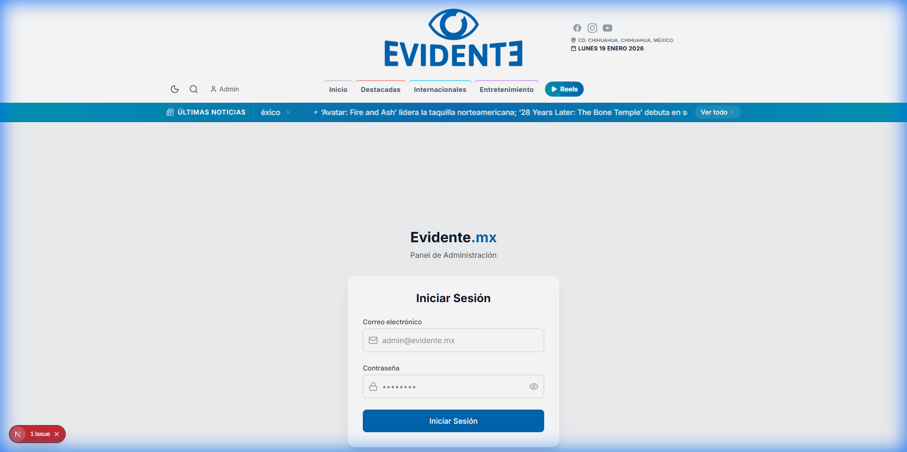

1. **Correo electrónico:** Ingresa `Publisher@evidente.mx`
2. **Contraseña:** Ingresa tu contraseña
3. Haz clic en **Iniciar Sesión**

---

## Paso 2: Ver el Dashboard

Después de iniciar sesión, verás el panel principal con estadísticas:

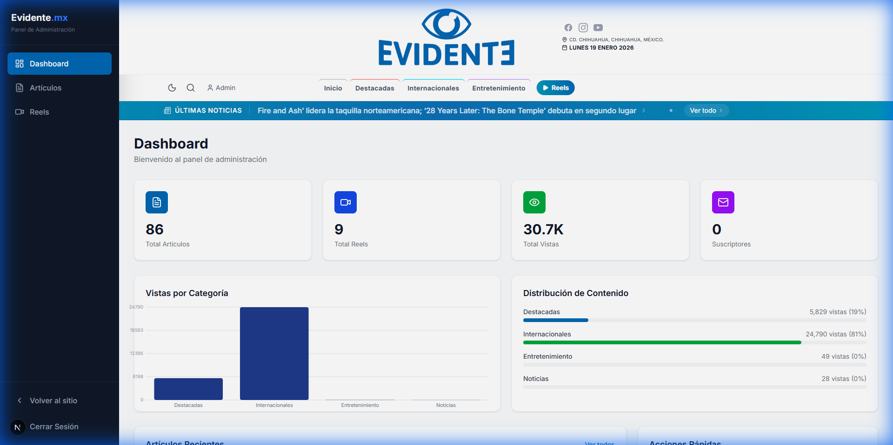

Aquí puedes ver:
- Total de artículos publicados
- Total de reels
- Vistas totales
- Gráficas de rendimiento

---

## Paso 3: Ir a la Sección de Artículos

Haz clic en **"Artículos"** en el menú izquierdo:

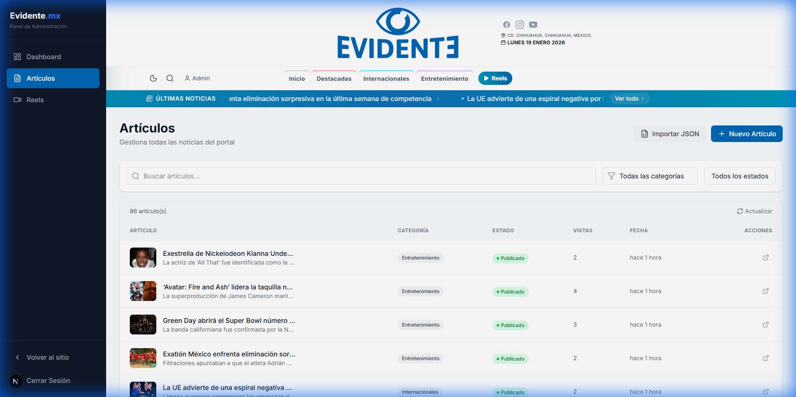

Para crear uno nuevo, haz clic en el botón azul **"+ Nuevo Artículo"** (esquina superior derecha).

---

## Paso 4: El Editor de Artículos

Al crear un nuevo artículo, verás esta pantalla:

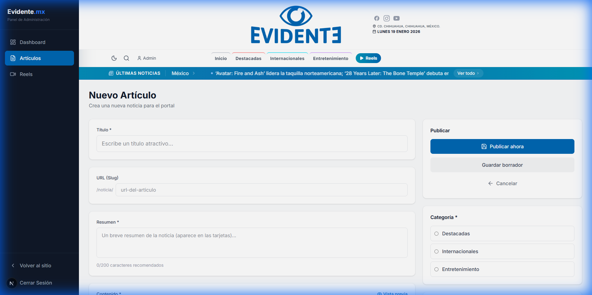

---

## Paso 5: Llenar el TÍTULO

El título es lo primero que verán los lectores. Escríbelo claro y llamativo.

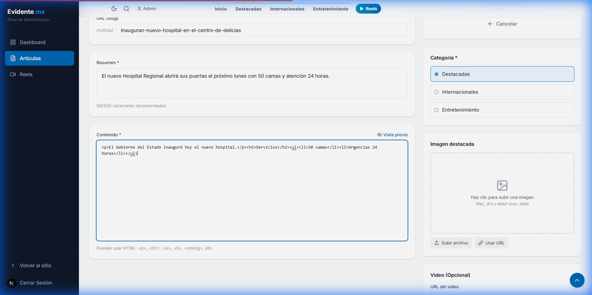

**Ejemplo:**
```
Inauguran nuevo hospital en el centro de Delicias
```

**Tips:**
- Máximo 80 caracteres
- No uses MAYÚSCULAS en todas las palabras
- Debe llamar la atención

---

## Paso 6: El SLUG se Genera Solo

El "slug" es la dirección web del artículo. **Se crea automáticamente** cuando escribes el título.

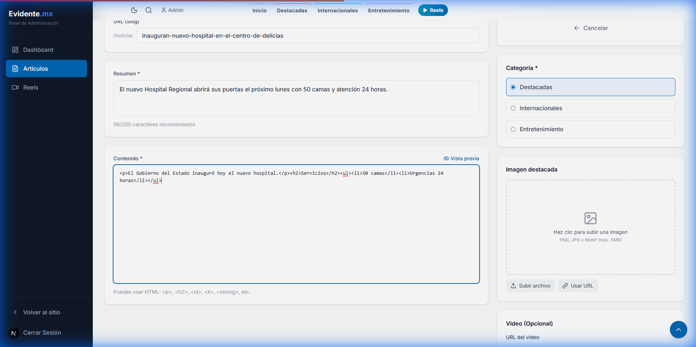

En este ejemplo genera:
```
inauguran-nuevo-hospital-en-el-centro-de-delicias
```

> [!TIP]
> **No necesitas editarlo.** El sistema lo crea solo.

---

## Paso 7: Escribir el RESUMEN

Es un texto breve de 1-2 oraciones que aparece en las tarjetas de la página principal.

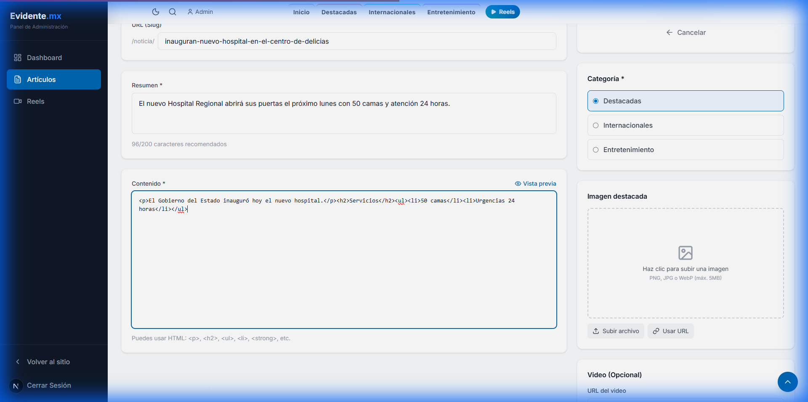

**Ejemplo:**
```
El nuevo Hospital Regional abrirá sus puertas el próximo lunes con 50 camas y atención 24 horas.
```

**Tips:**
- Entre 100-200 caracteres
- Resume lo más importante
- Debe llamar la atención para que hagan clic

---

## Paso 8: Escribir el CONTENIDO

Aquí escribes todo el artículo. Puedes usar código HTML para darle formato.

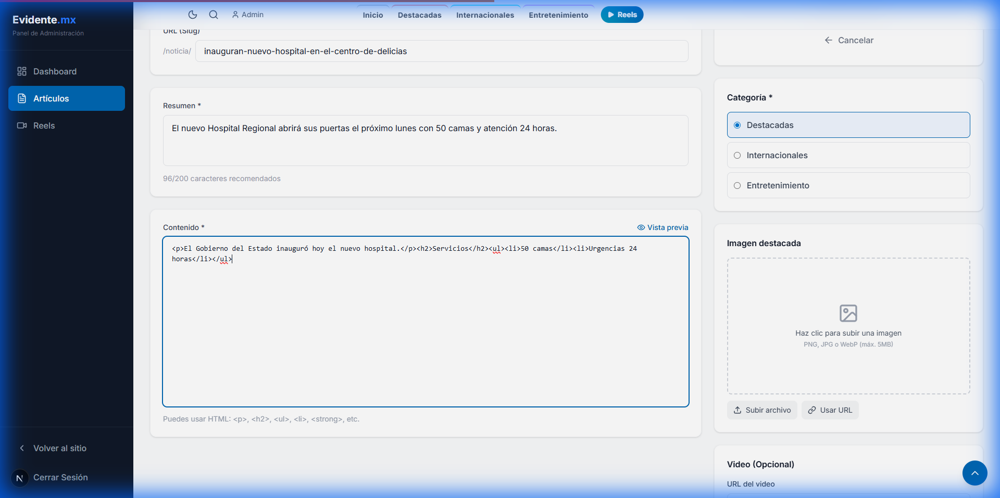

**Ejemplo de contenido:**
```html
<p>El Gobierno del Estado inauguró hoy el nuevo hospital.</p>

<h2>Servicios</h2>

<ul>
<li>50 camas</li>
<li>Urgencias 24 horas</li>
</ul>
```

### Etiquetas HTML que puedes usar:

| Etiqueta | Para qué sirve | Cómo se escribe |
|----------|---------------|-----------------|
| Párrafo | Texto normal | `<p>Tu texto aquí</p>` |
| Subtítulo | Títulos dentro del artículo | `<h2>Subtítulo</h2>` |
| Negritas | Texto **importante** | `<strong>texto</strong>` |
| Lista | Viñetas | `<ul><li>Item 1</li><li>Item 2</li></ul>` |

---

## Paso 9: Usar la VISTA PREVIA

Haz clic en **"Vista previa"** (arriba del campo de contenido) para ver cómo se verá tu artículo:

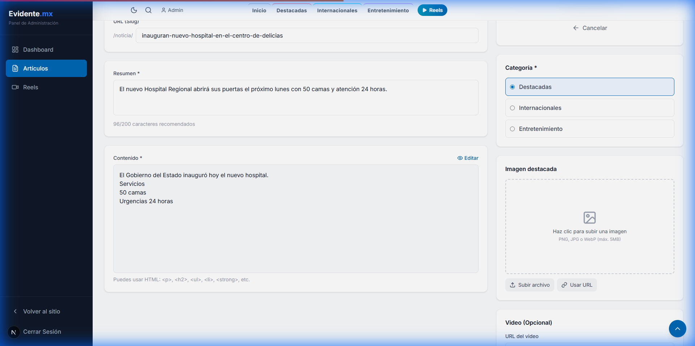

En esta vista puedes verificar que el HTML se vea correctamente antes de publicar.

---

## Paso 10: Seleccionar CATEGORÍA

En la barra lateral derecha, selecciona UNA categoría haciendo clic:

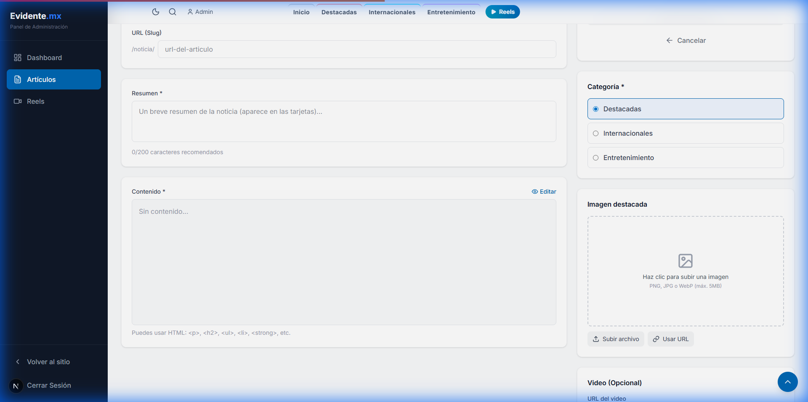

| Categoría | ¿Cuándo usarla? |
|-----------|-----------------|
| **Destacadas** | Noticias principales del día |
| **Internacionales** | Noticias de otros países |
| **Entretenimiento** | Espectáculos, cultura, eventos |

---

## Paso 11: Agregar IMAGEN DESTACADA

Esta es la imagen principal que aparece en la portada.

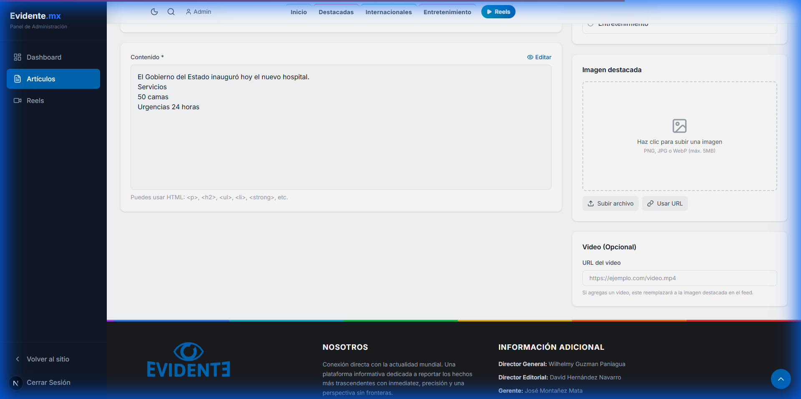

### Opción A: Subir Archivo

1. Haz clic en **"Subir archivo"**
2. Selecciona una imagen de tu computadora (JPG, PNG)
3. Espera a que se suba
4. ¡Listo!

### Opción B: Usar URL de Internet

1. Haz clic en **"Usar URL"**
2. Pega la dirección de la imagen

**¿Cómo obtener una URL de imagen?**

1. **Desde Google Imágenes:**
   - Busca una imagen
   - Haz clic derecho sobre ella
   - Selecciona **"Copiar dirección de imagen"**
   - Pégala en el campo

2. **Ejemplo de URL válida:**
```
https://upload.wikimedia.org/wikipedia/commons/a/ab/Hospital.jpg
```

> [!WARNING]
> **URLs que NO funcionan:**
> - Google Drive o Dropbox (son privados)
> - Facebook o Instagram (requieren login)

---

## Paso 12: PUBLICAR el Artículo

Cuando hayas terminado, mira la barra lateral derecha:

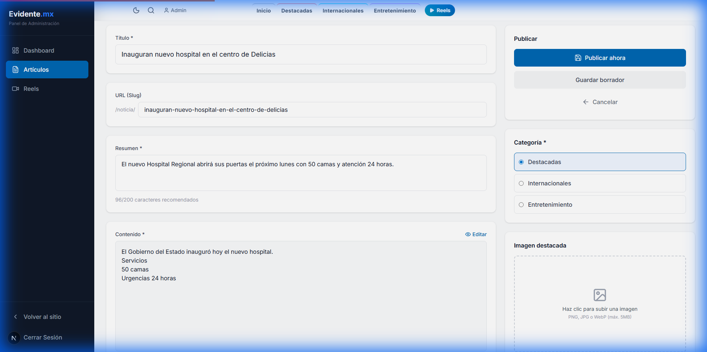

| Botón | Qué hace |
|-------|----------|
| **🔵 Publicar ahora** | La noticia aparece INMEDIATAMENTE en el sitio |
| **⚪ Guardar borrador** | Guarda SIN publicar (puedes terminarla después) |

---

## Resumen: Ejemplo Completo

Aquí tienes cómo llenar todos los campos:

| Campo | Ejemplo |
|-------|---------|
| **Título** | Inauguran nuevo hospital en el centro de Delicias |
| **URL** | (automático) inauguran-nuevo-hospital-en-el-centro-de-delicias |
| **Resumen** | El nuevo Hospital Regional abrirá sus puertas el próximo lunes. |
| **Contenido** | `<p>Texto...</p><h2>Subtítulo</h2><ul><li>Lista</li></ul>` |
| **Categoría** | Destacadas |
| **Imagen** | Subir archivo o pegar URL |

---

## ⚠️ IMPORTANTE: Tus Limitaciones

> [!CAUTION]
> **Como Publisher, NO puedes:**
> - ❌ Editar artículos después de publicarlos
> - ❌ Eliminar artículos
> - ❌ Gestionar otros usuarios
>
> **Si cometiste un error**, contacta al administrador.

---

## Problemas Comunes

| Problema | Solución |
|----------|----------|
| La imagen no carga | Verifica que la URL sea pública y termine en .jpg/.png |
| Botón "Publicar" está gris | Llena todos los campos requeridos (Título, Resumen, Contenido) |
| No veo mi artículo | Verifica que hayas dado clic en "Publicar ahora" |

---

**¿Dudas? Contacta al administrador.**

